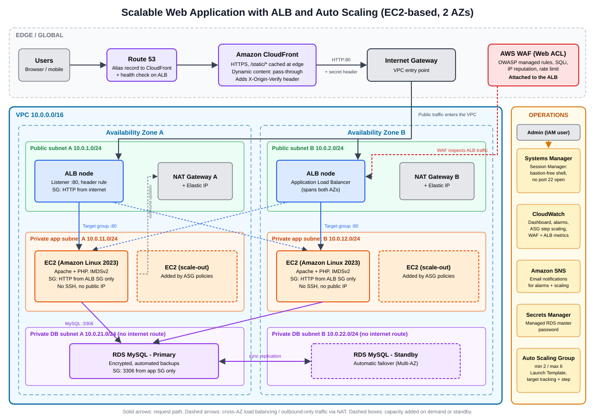

# Scalable Web Application with ALB and Auto Scaling on AWS

A production-style, highly available web application on AWS: EC2 instances in private subnets behind an Application Load Balancer, scaled automatically by an Auto Scaling Group, backed by a Multi-AZ RDS database, fronted by CloudFront and protected by AWS WAF.

## Solution Architecture

### Request flow

1. A user resolves the application name. With a custom domain, **Route 53** returns an alias record pointing to **CloudFront**; otherwise the user uses the `*.cloudfront.net` URL.
2. **CloudFront** terminates HTTPS, serves `/static/*` from its edge cache, and forwards everything else to the ALB with a secret `X-Origin-Verify` header.
3. The **ALB** (public subnets, both AZs) accepts only requests carrying that header; anything else gets a `403`. **AWS WAF** inspects traffic at the ALB.
4. The ALB forwards to **EC2 instances** in private subnets (one or more per AZ) managed by the **Auto Scaling Group**.
5. The instances read and write to **Amazon RDS MySQL (Multi-AZ)** in isolated database subnets.
6. Instances reach the internet for package updates only through **NAT Gateways** (one per AZ). Administrators use **SSM Session Manager**; there is no SSH, no bastion and no public IP on any instance.

## AWS services used

| Area | Service | How it is used |
|---|---|---|
| Network | VPC, subnets, route tables, IGW, NAT Gateways, NACLs, Security Groups | 2 AZs, 6 subnets (public / private app / private DB), one NAT Gateway per AZ, layered security |
| Compute | EC2, Launch Template, Auto Scaling Group | Amazon Linux 2023, IMDSv2 only, encrypted gp3 volumes, min 2 / max 6 instances |
| Load balancing | Application Load Balancer | Layer 7, HTTP listener, health-checked target group, spans both AZs |
| Security | AWS WAF | AWS managed rule groups (Common, Known Bad Inputs, SQLi, IP Reputation) plus a per-IP rate limit |
| Edge | CloudFront | HTTPS, static asset caching (`/static/*`), dynamic traffic not cached |
| DNS | Route 53 (optional) | Alias record to CloudFront and a health check on the ALB, created only when a custom domain is supplied |
| Database | RDS MySQL 8.0 Multi-AZ | Synchronous standby in the second AZ, encrypted at rest, 7-day backups, master password generated and stored in Secrets Manager |
| Access | Systems Manager Session Manager | Bastion-free shell access to instances |
| Secrets | Secrets Manager | Managed RDS master credentials, read by instances through an IAM role |
| Monitoring | CloudWatch, SNS | Dashboard, alarms, ASG scaling notifications, RDS failover events, email alerts |

## Design decisions

**High availability**
- Every tier spans two Availability Zones: ALB nodes, app instances, NAT Gateways and the RDS primary/standby pair.
- One NAT Gateway per AZ, each with its own route table, so losing an AZ does not break outbound access in the other.
- The ASG uses ELB health checks, so an instance that fails the application check is replaced, not only one that fails the EC2 check.
- RDS Multi-AZ fails over automatically; the app reconnects through the same endpoint.

**Scalability**
- Two target-tracking policies: average CPU at 50%, and 500 requests per target (ALB request count).
- One step-scaling policy driven by a CloudWatch alarm (CPU >= 70%): +1 instance for a moderate breach, +2 for a severe one.
- Instances are stateless; all state lives in RDS.

**Security (defence in depth)**
- Security groups chain by reference: internet -> ALB SG -> app SG -> DB SG. Each tier only accepts traffic from the tier in front of it.
- Network ACLs add a stateless layer: the DB subnets only accept MySQL from the two app subnets, and have no route to the internet.
- The ALB rejects requests that do not carry the CloudFront secret header, so the WAF and CloudFront cannot be bypassed by calling the ALB directly (only `/health.html` is exempt, for health checks).
- WAF managed rules cover common OWASP Top 10 risks (injection, XSS, known bad inputs); the rate-based rule limits abusive clients.
- IMDSv2 is enforced, EBS and RDS storage are encrypted, and no instance has a public IP or an open SSH port.
- The database password is never in the template: RDS generates it and stores it in Secrets Manager. The instance role can read only that one secret.

## Monitoring

- **Dashboard** `scalable-web-dashboard`: ALB requests and 5xx, target response time, ASG CPU and instance count, healthy/unhealthy targets, RDS CPU and connections.
- **Alarms** (notify the SNS topic): ALB 5xx count, unhealthy targets, RDS CPU, and ASG CPU (also triggers step scaling).
- **Notifications**: ASG launch/terminate/error events and RDS failover/failure/maintenance events.

## Cost

This design prioritises high availability, so it is not free-tier friendly. The main hourly costs are two NAT Gateways, the Multi-AZ RDS instance, the ALB and at least two EC2 instances; expect roughly a few US dollars per day in `us-east-1`.
